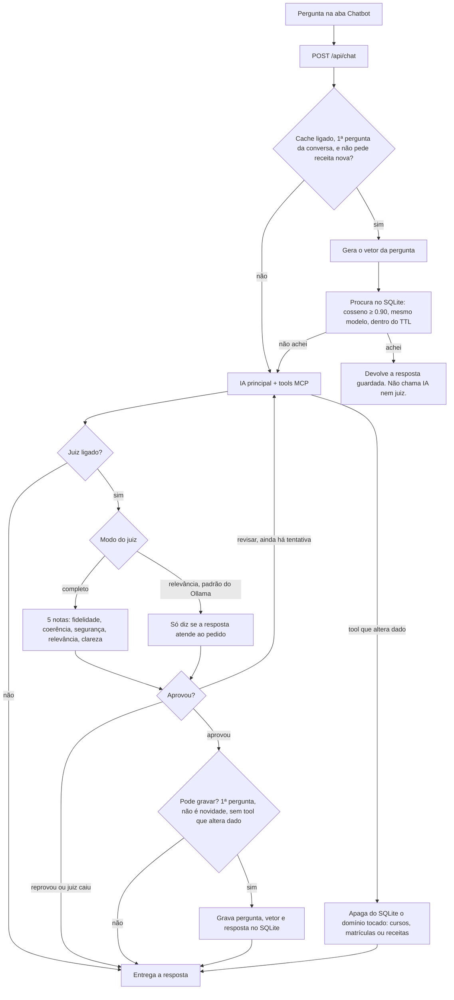

# Pipeline do cache e do juiz

O chat antigo ia direto da pergunta para a IA principal e as tools. Duas peças entraram no meio, as duas dentro do `app`:

- **Cache semântico:** guarda pergunta, vetor e resposta num SQLite do próprio app. Pergunta parecida devolve a resposta guardada e não chama a IA.
- **Juiz:** outra IA, diferente da que responde, lê a resposta pronta e diz se ela serve. Ollama (`qwen2.5:1.5b`) é uma das opções.

O banco dos cursos, matrículas e receitas continua o Postgres. O cache não mora lá.

## Onde cada coisa fica

| Peça | Onde | Liga com |
|---|---|---|
| Orquestração | `app/src/application/chat/answerQuestion.ts` | cache, depois IA, depois juiz |
| Regras do que entra no cache | `app/src/application/chat/cacheRules.ts` | — |
| Arquivo das perguntas | `CACHE_DB_PATH`, padrão `./data/cache.sqlite` | volume Docker `cookings_cache` em `/app/data` |
| Vetor da pergunta | `EmbeddingPort` | `EMBEDDING_PROVIDER`: `mock`, `gemini` ou `openai` |
| Juiz completo (5 notas) | `LLMJudgeAdapter` | `JUDGE_PROVIDER`: `gemini`, `claude`, `gpt` |
| Juiz leve (só "atende?") | `RelevanceJudgeAdapter` | padrão quando `JUDGE_PROVIDER=ollama` |
| Modelo local do juiz | `ollama/` + `OllamaAdapter` | `http://ollama:11434`, modelo `qwen2.5:1.5b` |
| Selo na tela | aba Chatbot | `resposta do cache` e `juiz: …` |

`EVAL_LOG_PATH` não é esse banco. É um diário opcional, uma linha JSON por resposta. Vazio = desligado.

## Pipeline

## Cache

Consulta o arquivo só quando as três coisas são verdade:

1. `CACHE_ENABLED=true`
2. a conversa tem exatamente uma mensagem do usuário (a segunda pergunta do mesmo fio não usa o cache)
3. o texto não pede novidade (`invente`, `outra`, `diferente`, `surpreenda`)

A pergunta é normalizada: sem acento, minúscula, espaços colapsados. A comparação é por similaridade (cosseno), padrão `0.90`, não por texto idêntico. Entrada vence em `CACHE_TTL_MINUTES` (padrão 60).

Grava só se o juiz aprovou, a pergunta passou nas regras acima e nenhuma tool mudou dado (cadastrar, matricular, criar receita, salvar receita gerada). Se uma dessas tools rodou, as entradas daquele domínio saem do arquivo.

Falha de embedding ou de disco vira "não achei" e o chat segue. Hit de cache não chama a IA principal nem o juiz.

## Juiz

`JUDGE_PROVIDER` deve ser outro provedor que `LLM_PROVIDER`. Opções: `mock`, `gemini`, `claude`, `gpt`, `ollama`. O chat principal não usa Ollama.

Dois modos (`JUDGE_MODE`):

- **completo** (padrão de gemini, claude e gpt): cinco notas de 1 a 5. Aprova se todas são ≥ 4 e não há problema bloqueante (dado que não está na ferramenta, alérgeno escondido, instrução insegura). O prompt vê as evidências das tools.
- **relevancia** (padrão do Ollama): o modelo pequeno só responde se a resposta ficou no assunto. `atende: true` vira aprovar. `atende: false` vira revisar ou reprovar.

`JUDGE_MAX_REVISIONS` (padrão 1) manda a IA principal reescrever uma vez. Se continuar ruim, a resposta sai com o aviso de que o juiz não aprovou.

Se o juiz cai (sem chave, JSON inválido, tempo estourado na nuvem), a resposta é entregue mesmo assim e não entra no cache. Ollama não tem esse teto de tempo: a avaliação espera o modelo local terminar.

O mock aprova tudo, exceto respostas com `[[REVISAR]]`, `[[REPROVAR]]` ou `[[INDISPONIVEL]]`. Serve para teste sem modelo.
